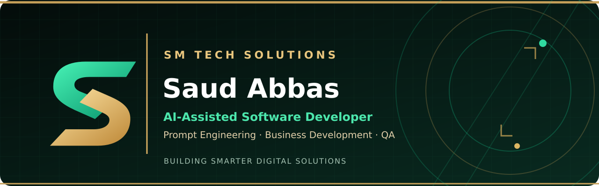

<div align="center">



<br/>

### Building practical software. Solving real business problems.

**AI-Assisted Software Developer** &nbsp; · &nbsp; **Prompt Engineer** &nbsp; · &nbsp; **Business Development**


<br/>

[](mailto:msaudabbas05@icloud.com?subject=SM%20Tech%20Solutions%20Inquiry)
[](https://www.linkedin.com/in/saud-abbas-3876ab248)
[](CV.md)
[](https://wa.me/923152515975)

**[ABOUT ME](#-about-me)** &nbsp; • &nbsp; **[FEATURED WORK](#-featured-work)** &nbsp; • &nbsp; **[SKILLS](#-skills--toolkit)** &nbsp; • &nbsp; **[SERVICES](#-sm-tech-solutions)** &nbsp; • &nbsp; **[CONTACT](#-lets-connect)**

</div>

---

## ✨ About Me

```text
NAME       Saud Abbas
BRAND      SM Tech Solutions
EDUCATION  BS Computer Science — University of Central Punjab (2026)
FOCUS      AI-assisted software • Prompt engineering • Business development
MISSION    Building smarter digital solutions for real business needs
```

I'm a computer science graduate who works at the intersection of **software development, business operations and AI-assisted workflows**. I focus on turning real client requirements into useful products—from **custom management systems** to **websites, dashboards and automation**.

Alongside technical work, I'm interested in **client acquisition, requirements analysis, QA/testing, deployment and project coordination**. My role across projects can include AI-assisted implementation, designing workflows, testing, specification and collaborating with developers.

---

## 🚀 Featured Work

<table>
<tr>
<td width="50%" valign="top">

### 🍊 SM Kinnow Factory Pro
**Factory Management System**

Truck processing, peti records, khata ledgers, cash and bank entries, payment flows, slips and reports.

`Business workflows` `Reporting` `QA`

**Private business project**

</td>
<td width="50%" valign="top">

### 🤖 SM AI Client Hunter
**Lead Discovery + Remote Job Finder**

Client discovery, reviewed outreach, remote-job search and meeting/interview tracking for SM Tech Solutions.

`Web App` `Automation` `Railway`

**[View Live Application](https://sm-client-hunter-production.up.railway.app)**

</td>
</tr>
<tr>
<td width="50%" valign="top">

### 📒 SM Bulk Supply / Mandi
**Trade & Accounting Workflows**

Party accounts, trading ledgers, printable statements and business-management flows.

`Business Software` `Ledgers` `Reports`

**[View Repository](https://github.com/saudabbas05/sm-bulk-supply)**

</td>
<td width="50%" valign="top">

### 🏠 SM HomeFix
**Home Services Platform**

Service marketplace idea with Node.js/NestJS APIs and city-management functionality.

`Node.js` `NestJS` `REST API`

**In development**

</td>
</tr>
<tr>
<td width="50%" valign="top">

### 🏢 Hostel Management
**Rent & Tenant Tracking**

Room allocations, tenants, rent statuses, receipts and daily operational records.

`Dashboard` `Operations` `Tracking`

**Private business project**

</td>
<td width="50%" valign="top">

### 🚘 SM Scott Motors
**Automotive Web Presence**

Business web presentation and digital brand experience.

`Website` `Branding` `UI`

**[View Repository](https://github.com/saudabbas05/sm-scott-motors)**

</td>
</tr>
</table>

<details>
<summary><b>More business projects</b></summary>

<br/>

- **SM Commerce Desk:** e-commerce sourcing, orders, supplier discovery and profit workflows
- **SM FARMSS:** agriculture export business and [online presence](https://smfarmss.com)
- **SM Agro Supplies:** agricultural-products storefront concept

</details>

<sub>Some projects are private, in development or AI-assisted. Project roles vary and may include implementation, planning, workflow design, QA and coordination; not every project was coded independently.</sub>

---

## 🧰 Skills & Toolkit

<div align="center">

**Development & technology**


**Tools & deployment**


**Professional focus**

`AI Prompt Engineering` &nbsp; `AI-Assisted Development` &nbsp; `Manual QA` &nbsp; `Business Development`  
`Requirements Gathering` &nbsp; `UI Testing` &nbsp; `Project Coordination`

</div>

---

## 💼 SM Tech Solutions

<div align="center">


### Your ideas. Our digital solutions.

</div>

| 💻 Build | ⚡ Automate | 📊 Optimize |
|:---|:---|:---|
| Business websites | AI-assisted workflows | Dashboards & reporting |
| Custom software | Operational automation | CRM / ERP-style systems |
| Responsive web apps | Data entry processes | QA & usability review |

**How we work:** Discover requirements → Scope the solution → Develop & test → Review → Deliver & improve.

---

## 🎓 Education

**Bachelor of Science in Computer Science**  
University of Central Punjab, Lahore · **2026**

---

## 🤝 Let's Connect

Open to discussions about **custom software, websites, workflow automation, AI-assisted solutions** and suitable **remote roles** in software, QA and business development.

<div align="center">

**📧 [Email](mailto:msaudabbas05@icloud.com?subject=SM%20Tech%20Solutions%20Project%20Inquiry)** &nbsp; | &nbsp;
**💼 [LinkedIn](https://www.linkedin.com/in/saud-abbas-3876ab248)** &nbsp; | &nbsp;
**💬 [WhatsApp](https://wa.me/923152515975)** &nbsp; | &nbsp;
**📄 [Resume](CV.md)**

<br/>

**SM Tech Solutions**  
*Building Smarter Digital Solutions.*


</div>
